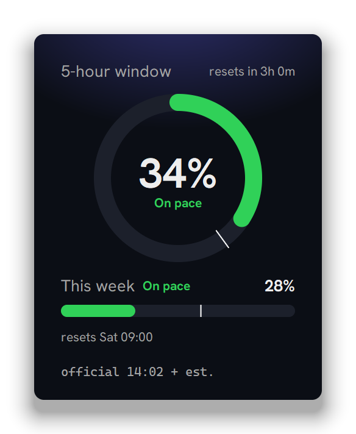
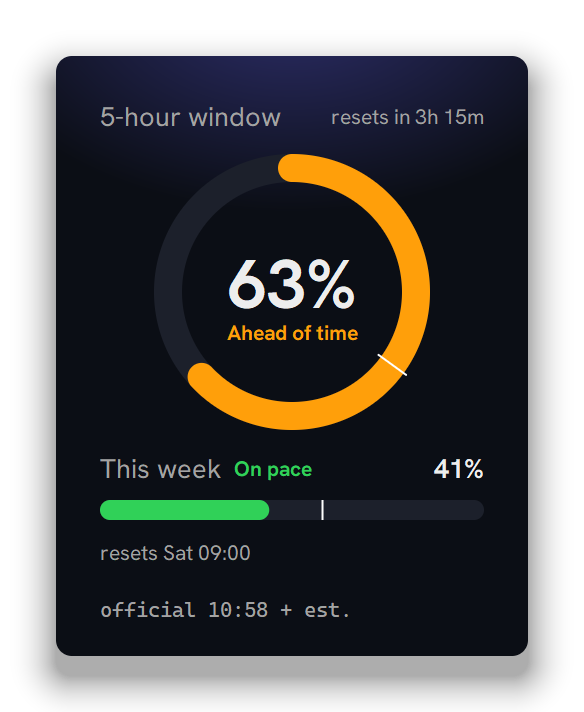
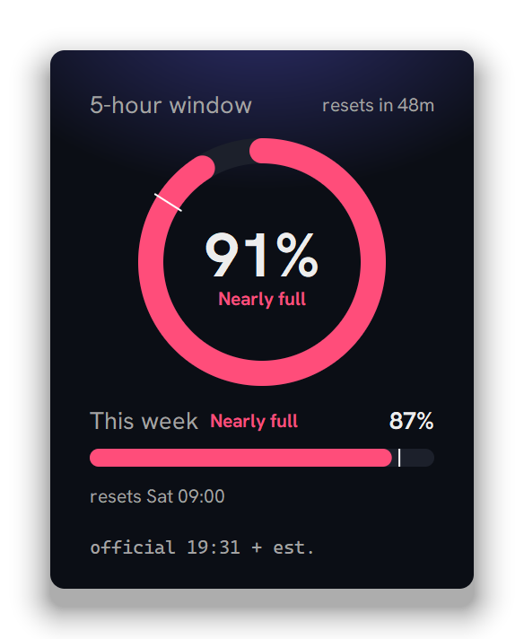
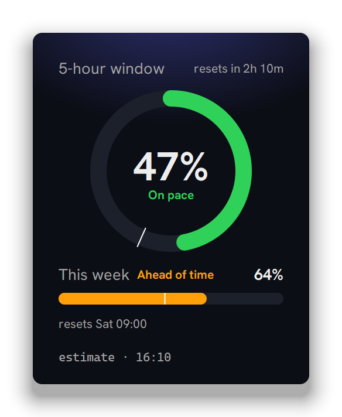
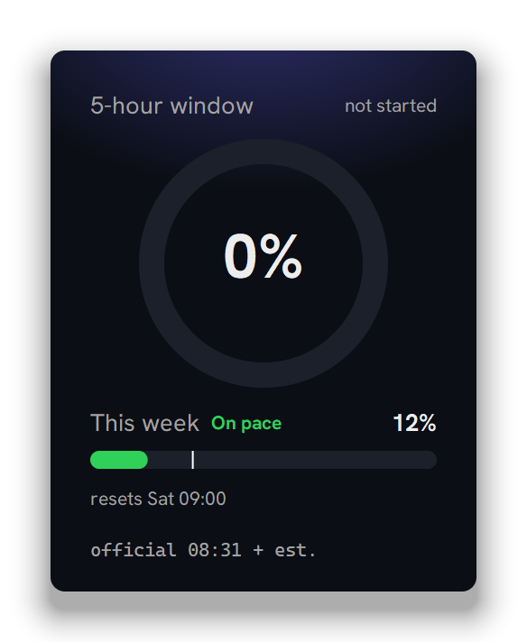

<div align="center">

# Claude usage widget

[English](README.md) | **简体中文**

一个 Windows 桌面小组件，显示你的 Claude Max 套餐用了多少：<br>圆环是 5 小时窗口，横条是本周额度。



</div>

## 每种颜色都有含义

圆环和横条上的白色细线，表示这个窗口的时间已经过了多少。绿色表示你的用量跟时间走得差不多。

<table>
  <tr>
    <td align="center" width="25%"></td>
    <td align="center" width="25%"></td>
    <td align="center" width="25%"></td>
    <td align="center" width="25%"></td>
  </tr>
  <tr>
    <td align="center"><b>Ahead of time</b><br>橙色：比时间快了十个百分点以上。</td>
    <td align="center"><b>Nearly full</b><br>85% 起变粉色。</td>
    <td align="center"><b>只有估算</b><br>还没有官方读数，全部是估算。</td>
    <td align="center"><b>Not started</b><br>下一次请求时，新的 5 小时窗口才开始。</td>
  </tr>
</table>

## 功能

- **先用官方数字。** 一个小小的 Claude Code mod 会写下你真实的 5 小时和每周百分比，小组件再加上之后用量的估算。
- **没有 mod 也能用。** 它会从 Claude Code 的对话记录估算，从不碰你的 Claude 登录。
- **用完之前提醒你。** 照最近半小时的速度，5 小时窗口会在重置前用满时（每周按最近一天的速度算），它会显示还剩多久，并响一声提示音。到 90% 再提醒一次。
- **不挡路。** 它待在桌面上、所有窗口后面，按 Win+D 时才到前面来；不在任务栏，也不在 Alt+Tab 里。
- **什么都不用装。** 只用 Python 和 tkinter，没有第三方包。每 30 秒更新一次。

## 快速开始

在这个文件夹里打开 PowerShell：

```powershell
pythonw widget.py
```

拖动可以移动它，右键可以退出。

想要官方数字，就在 Claude app 里的 Claude Code 输入框装上 `usage-file` mod：

```
/plugin marketplace add C:\path\to\claude-usage-widget
/plugin install usage-file@claude-usage-widget
```

登录 Windows 时自动启动：

```powershell
python startup.py
```

<details>
<summary><b>数字是怎么来的</b></summary>

- mod（在 `mod\`）每当数字变动，就把你真实的百分比写进 `%USERPROFILE%\.claude\usage-widget\usage.json`。它没有界面、不联网，只写这一个文件。底部会显示 `official 14:02 + est.`：14:02 的官方读数，加上之后用量的估算。
- 估算是把 Claude Code 对话记录里的每一次回复（编辑器插件和 Claude app 都会写）换算成额度的一部分。没有可用的读数时，底部显示 `estimate · 14:02`。通常和 Claude 的用量页面差几个百分点，但有些窗口会差到五分之一左右。
- 官方读数只在 Claude app 的会话收到回复时才会更新。mod 需要 Claude Code 2.1.287 或更新的版本，编辑器插件里的可能太旧，所以整天在那里工作时，用的就是估算。
- `/plugin uninstall usage-file@claude-usage-widget` 可以移除 mod，小组件就回到只用估算。

**数字跑偏的话：** `usage_estimate.py` 顶部的 `FIVE_HOUR_FULL` 和 `WEEKLY_FULL` 把 token 用量换算成百分比。在 Claude app 的会话里请 Claude 检查 usage widget：它会读你真实的用量，再运行 `scratch\check_accuracy.py`，列出最合适的值。低于 20% 的读数太粗，不适合用来调。

</details>

<details>
<summary><b>开机自动启动</b></summary>

`python startup.py` 会在你的「启动」文件夹放一个叫 `Claude usage widget` 的快捷方式（Win+R，输入 `shell:startup`）。删掉它就不会自动启动。

这个快捷方式运行 `Claude Usage.exe`，是 Python 的 `pythonw.exe` 改名后的副本，所以任务管理器里显示为「Claude Usage」。它运行的还是这个文件夹里的 `widget.py`，所以改了代码只要重启它。重装 Python 或移动这个文件夹会让快捷方式失效：退出小组件，再运行一次 `python startup.py`。

同一时间只会有一个在运行。它会在你上次放的位置打开（记在 `data\position.json`）。

</details>

<details>
<summary><b>开发</b></summary>

| 命令 | 作用 |
|---|---|
| `python -m unittest discover -s tests` | 运行测试 |
| `python scratch\check_accuracy.py` | 对比估算和 Claude 的真实数字 |
| `python scratch\shoot.py .github\readme` | 用测试数据重拍这些截图 |
| `claude plugin test mod` | 运行 mod 的测试（用 Claude app 自带的 `claude.exe`，见 CLAUDE.md） |

字体是 Hanken Grotesk（SIL Open Font License），从 `fonts\` 加载，只给小组件用；没有这些文件时用 Segoe UI。

</details>
